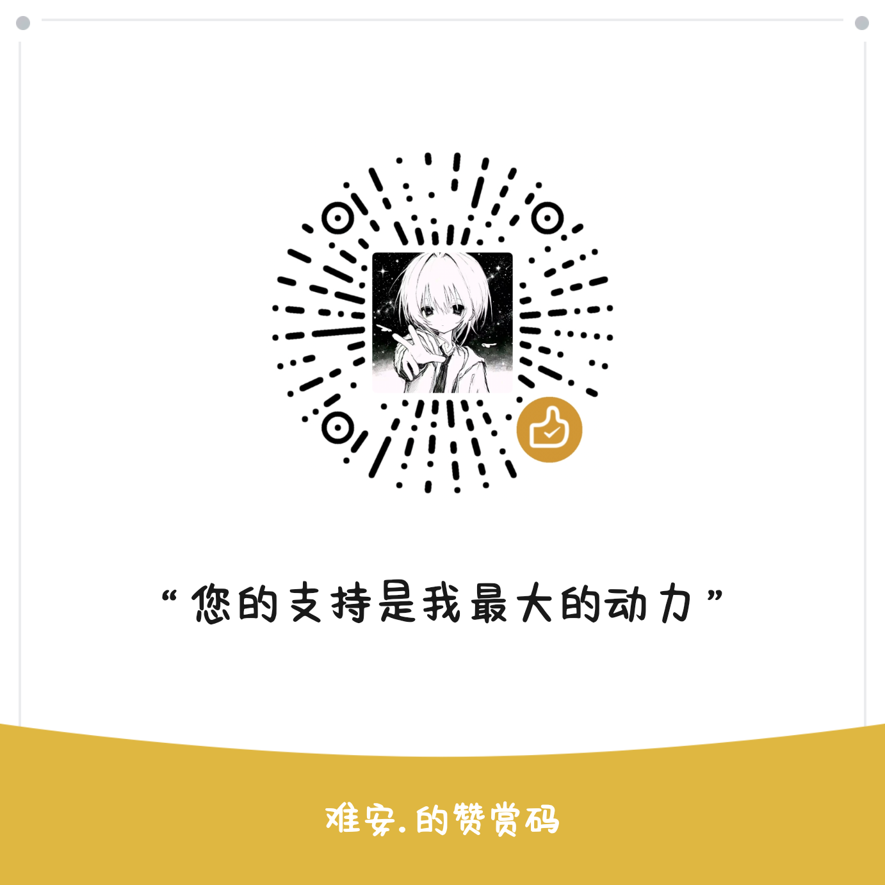

# 交接说明（下一轮从这里读）

> 这一节是给下一个对话/开发者的交接文档，写在 README 最前面；下面才是项目本身的 README。
> 最近一轮**把识图（多模态）真正打通了** —— 之前几轮卡住的 `mtmd_tokenize ... std::bad_alloc`
> 根因是 JNI 里少给一个字段（`mtmd_input_text.text_len`），不是 llama.cpp 的 bug。
> 同一轮还修了几个「用了没效果」的洞（mmproj 在预热/自动切模型时被丢、识图槽位是摆设）、
> 把内置清单补上两个多模态模型，并加了可复现的内置插件打包脚本。
> 第 1 节是**已经验证过、不要回退**的东西；第 2 节是剩下的活。
>
> 本轮（版本号仍是 **1.0.5** / versionCode 11）补了三件事：**人设终于有入口**（§1.9）、
> **外观新增界面布局 / 底栏形状 / 风格配色**（§1.11）、**关于页支持作者那段加了一句话**。

## 0. 环境、构建、验证

- 仓库：`D:\aichat\LocalMind`（Compose App）；上游 LiquidTab 源码：`D:\aichat\lt\LiquidTab-main`（GPL-3.0，只作参考，不要整文件粘）。
- 构建：
  ```powershell
  $env:JAVA_HOME='C:\Program Files\Microsoft\jdk-17.0.20.101-hotspot'
  $env:ANDROID_HOME='C:\Users\16505\AppData\Local\Android\Sdk'
  cd D:\aichat\LocalMind
  .\gradlew.bat :app:assembleDebug
  adb -s emulator-5554 install -r app\build\outputs\apk\debug\app-debug.apk
  ```
- 模拟器：`emulator-5554`，1080×2400，density 420，**SwiftShader 软件 GLES**，2.5 GB 内存 / 4 核。
  - 因此 `RenderNode + RuntimeShader` 的 RenderEffect 链在这个模拟器上会整块渲染成透明；
    `LiquidBarGlass` 里必须保留 `Paint + BitmapShader` 的降级路径，真机才走 AGSL。
  - 模拟器默认网络是 3G 档；`adb emu network speed full` 能放开限速，但从这台机器到
    GitHub 直连本来就慢（实测 30–40 KB/s），下 36 MB 的语音引擎要十几分钟。
- 截图/素材目录：`D:\aichat\_shots`（本轮关键几张：`s12` 内置音色、`s15` 多选、`s16` 内存模式）。
- 偏好设置（theme_overrides）在 `shared_prefs/localmind.xml`，JSON 字符串。改法：
  ```powershell
  adb -s emulator-5554 exec-out run-as com.localmind cat shared_prefs/localmind.xml > prefs.xml
  adb -s emulator-5554 push prefs.xml /data/local/tmp/prefs.xml
  adb -s emulator-5554 shell "run-as com.localmind cp /data/local/tmp/prefs.xml shared_prefs/localmind.xml"
  ```
- 生图原生库默认**不打包**：要带 SD 用 `.\gradlew.bat :app:assembleSdPlugin` 或 `-PwithSdLib=true`。

### 0.1 GitHub Actions（云端出包，不用本机编）

仓库：`isnananya/LocalMind-Android`（**私有**）。push 到 `main` 会自动出 APK。

| 想干嘛 | 怎么做 |
| --- | --- |
| 拿一个 APK 装到手机上 | push 到 `main` → Actions 页面下 `LocalMind-release-apk` artifact |
| 出一个带版本号的正式包 | `git tag v1.0.8 && git push origin v1.0.8` → 自动发 GitHub Release，APK 直接挂在 Release 上 |
| 重跑一次构建 | Actions 页面点 `Re-run all jobs` |
| 手动触发 | Actions → `Build APK` → `Run workflow` |
| 编生图后端静态库（可选） | Actions → `Build native prebuilt` → 填版本号手动跑，产物发到 Release |

命令行取包：

```bash
gh run list --repo isnananya/LocalMind-Android
gh run download <run-id> --repo isnananya/LocalMind-Android --name LocalMind-release-apk
```

**首次全新构建约 20 分钟**（要编 llama.cpp 的几百个 C++ 单元）；之后有 CMake/Gradle
缓存，通常 5–8 分钟。

两个依赖的版本是**钉死**的，别改成"拉最新"：

| 依赖 | 钉在 | 为什么 |
| --- | --- | --- |
| llama.cpp | `v0.6.0` | native 层（`llama_jni.cpp`）是照着 v0.6.0 的 API 写的。上游已到 v0.9.0，克隆 main 会因 API 变更编译失败 |
| stable-diffusion.cpp | `d763dae3b` + `third_party/patches/sd-conv-direct.patch` | 本机验证过的是「上游 d763dae3b + conv_direct_mode 补丁」这个组合，补丁已入库（21 文件 695 行），`git apply -p1` 后与本机快照逐字节一致 |

## 1. 已完成、不要回退

### 1.1 液态底栏（已内置，不是插件）
- 文件：`ui/components/LiquidGlassTabBar.kt`、`ui/components/LiquidBarGlass.kt`、`ui/components/GlassBackdrop.kt`。
- 内置化：`data/BuiltinPlugins.kt` 里 `com.localmind.bar.liquidtab` 已删除；
  `ui/screen/PluginsScreen.kt` 列表过滤掉旧记录；`ThemeScreen` 只留一个「液态底栏」总开关。
- 关键常量（**照抄 LiquidTab，别再"优化"**）：
  - 面板填充 `fillAlpha = 0.40`；
  - 胶囊：`pillInset = 4dp`、`pillTop = 4dp`、radius = h/2（**不要 clamp 到 18dp**）；
  - 胶囊静止：模糊图 + 10% 白/黑 + 16% 轻透镜；按压：缩放 1.36 + 清晰图 + 色散透镜；
  - 长按拖动：整条放大 8%、阴影 12→22dp、透镜 ×1.5、**采样要加 dragY**；
  - 默认模糊 10dp，抓图 `SAMPLE = 3`。
- 手势（1.0.6 二次修正，**别再退回 Compose 的现成检测器**）：标签按钮是 clickable，
  它会消费 DOWN，于是 `awaitLongPressOrCancellation` / `awaitHorizontalTouchSlopOrCancellation`
  一看 isConsumed 就取消 —— 表现就是"长按只放大、拖不动"。现在是自己写的指针循环：
  在 **PointerEventPass.Initial** 读事件（子级还没消费），自己判方向/长按；长按用
  `scope.launch { delay(longPressTimeout) }` 置 `grabbed`，**不要**在指针作用域里
  `withTimeout`（AwaitPointerEventScope 是 @RestrictsSuspension）。
  - 起手在选中胶囊上 + 横向过 slop → 拖胶囊（不用先长按）；
  - 长按之后 → 横向拖胶囊 / 纵向拖整条底栏；
  - 其它情况一律不接管，点按照常给按钮。
- 胶囊折射的是**底栏上的内容**（图标/文字），不是底下的页面：Row 用 GraphicsLayer 录一份
  内容位图（`rememberGraphicsLayer` + `drawWithContent`），胶囊画在 Row **之上**：
  先铺底栏自己的磨砂底（盖住原始图标）→ 内容位图过透镜 → 10% 叠色/高光。
  旧实现直接采样窗口截图，胶囊就成了底栏上的一个"洞"，透出页面内容。

### 1.2 外观设置（顺序固定）
`ThemeScreen.kt`：宽度（悬浮胶囊/通栏）、选中态（圆形/下划线/圆点/无）、液态底栏、底部渐变模糊、
描边、动态配色、底栏模糊半径、高光强度、底栏高度、单栏宽度、距底距离、仅图标、文字大小、图标大小、隐藏底栏。
令牌在 `data/UiTheme.kt`；动态配色在 `ui/theme/DynamicAccent.kt`，在 `ui/AppTheme.kt` 合并。

### 1.3 内置音色 + 多选（本轮 A，做完了）
- **`data/BuiltinVoices.kt`**：4 个内置音色，只放 **VITS / Piper**（原因见 §3.2）：
  `vits-piper-zh_CN-chaowen-medium-int8`（13 MB）/ `...huayan-medium`（64 MB）/
  `vits-zh-hf-fanchen-unity`（114 MB）/ `sherpa-onnx-vits-zh-ll`（113 MB）。
- **合并规则**（`data/VoiceCatalog.kt` 的 `setFromPlugins`）：内置按声明顺序在前；
  插件里**同 id 的条目覆盖**内置那一份（插件可以改地址/文案/镜像）；插件独有的追加在后面。
  所以「没装插件也有音色」和「换地址不用发版」同时成立。
- **语音页多选**（`ui/screen/VoiceScreen.kt`）：右上「多选 / 完成」；行首圆形勾选框（已装的也能勾）；
  底部固定「下载所选 (n) / 删除所选 (n)」，n 是**可执行的数量**（已装的不计入下载）；
  退出多选恢复行内「使用/试听/删除」。「使用」仍然单选（sherpa 引擎单实例）。
- 批量下载并发 **2**：`AppViewModel.downloadVoices` 用 `Semaphore(2)` + `VoiceModelDownloader.await`
  （`install()` 只起协程就返回，不限流的话会同时开 N 个下载）。批量删除走 `Dispatchers.IO`。
- **Breeze 入口撤掉**：TTS 页右上圆形按钮和「外部引擎」分组已删除；
  `service/BreezeTts.kt`、`ui/screen/BreezeScreen.kt` 保留（有服务器的用户仍可走）。
  「我的」页（`ui/design/MePage.kt`）本来就没有 Breeze 入口。
- 插件里的 `url / mirrors` **现在真的生效**：下载器改走 `VoiceCatalog.urlsFor(voice)`，
  之前按 id 现拼 URL，插件的镜像字段是死的。
- **修了一个会让进程直接消失的崩溃**：Piper 类音色（`vits-piper-*`）的包里带
  `espeak-ng-data/`，旧代码只找 lexicon/tokens、`data_dir` 传空 → sherpa 的 VITS 前端
  落到最后一条分支，打一行 "Not a model using characters as modeling unit" 然后
  `SHERPA_ONNX_EXIT(-1)`（真机上是 exit 255：没有 Java 栈、没有 tombstone）。
  现在 `resolve()` 会找 `espeak-ng-data` 并传 `dataDir`；另加一道前端闸门：
  非 characters 前端、又不是 piper+dataDir、又没有 lexicon 的音色直接标成"用不了"，
  **绝不进原生**。旧版本因此被拉黑的音色，升级后清一次黑名单（看门狗仍然有效）。

### 1.4 低端模式（本轮 B，做完了）
- `data/MemoryPlanner.kt` 的 `lowEndPolicy(context)`（按 `totalMem`）：

  | 总内存 | ctx 上限 | batch 上限 | KV |
  |---|---|---|---|
  | < 4 GB | 1024 | 128 | q8_0 |
  | < 6 GB | 2048 | 256 | q8_0 |
  | < 8 GB | 4096 | 512 | q8_0 |
  | ≥ 8 GB | 用户设置 | 用户设置 | 用户设置 |

- `plan()` 新增 `policy` 参数（默认自己算）、`recommendedBatch`、`lowEndNote`；
  `n_ctx = min(内存预算, 档位上限)`，夹了会写进 `warnings`。
- `LlamaEngine.load`：用 policy 的 KV 精度估 KV（否则按 f16 估保守一倍），
  `kvCode / batch / ubatch` 都按档位落到原生；`nCtx` 用 `plan.recommendedContext`。
- 线程：`bigCoreCount()` 读 `/sys/.../cpuinfo_max_freq` 数**最高一档**的核数，
  `recommendedThreads()` 夹在 2–6；读不到退回 `autoThreads()`。
  设置页「自动（N）」必须调 `recommendedThreads()`。
- 展示：设置页「内存模式」**常显**（不依赖加载模型）、状态页「内存模式」、模型详情、设置页内存规划。
- 模拟器实测（2.5 GB）：显示「低端模式 · 2.4 GB 内存 · ctx 1024 · KV q8」，自动线程 4。

### 1.5 其它已完成
- 捐赠榜按金额降序（`AboutScreen.kt` 的 `Donors`）。
- 状态页「正在使用」实时卡：引擎每 200 ms 推一次进度（不要改成每 token，重组会炸）。
- 本地 TTS 优先：`AppViewModel.speak()` = 本地神经音色 → Breeze → 系统 TTS。
- 语音引擎下载有百分比了：`SherpaLibraryInstaller.onProgress` → `VoiceDownloader.installLibrary`。
- 引擎安装抗中断：下完写 `.ok` 标记，只有标记在才复用 tarball；解压失败会删包重下。
  原来只按 `> 40 MB` 判断，被杀过一次的半包会被当成"已完成"，之后每次安装都失败。

### 1.6 生图质量 / 对话提示词（1.0.5 这一轮）
- **风格真正进扩散链路**：`service/ImagePrompts.kt` 把「用户输入 + 风格英文词 + 质量词」
  拼成正向提示词，并给默认负面词（低清/糊/水印/畸形手/多肢体）。
  以前 `ImageStyle` 只影响程序化渲染器，扩散模型收到的就是用户那一句话。
- **步数/CFG/采样器**：普通 SD1.5/2.1 → 24 步、CFG 7、`dpm++2m + karras`；
  SDXL → 25 步、1024²（跳过快速放大）；LCM → `lcm+lcm`；
  Lightning/Turbo/DMD → 4 步、CFG 1、`euler_a+discrete`
  （**Lightning 不是 LCM**，之前把它归到 LCM 会直接出花图）。
- 界面提示「扩散模型只认英文提示词」；负面词可覆盖。
- **对话不再注入初始提示词**：`AI_CHAT_DEFAULT_PROMPT` 和
  `GenerationSettings.DEFAULT_SYSTEM_PROMPT` 都改成空串；旧默认值只用于迁移识别
  （用户自己写的人设不会被清）；空系统提示词时不发 SYSTEM 消息。
- 语音页「使用中」错位：标题让出宽度（`weight(1f, fill=false)` + 省略号），
  徽标 `softWrap=false`，不再被压成竖排。
- 底栏拖动**实时切页**：胶囊经过哪一格就调 `onSelect`（只在换格时），
  拖动中 `LaunchedEffect` 不再把胶囊拉回旧位置。
- **底栏固定**：去掉了"长按抓起整条底栏上下拖"（`dragY` 恒 0、无放大/加深阴影）。
  只有胶囊可以横拖；长按只对胶囊生效。
- **作品全屏预览 + 保存相册**：点缩略图 → 全屏（Fit/黑底/关闭）；长按 → 保存/取消；
  保存走 MediaStore `Pictures/LocalMind/`（< Android 10 退回文件 + MediaScanner）。
  实现在 `ui/screen/ImageScreen.kt` 的 `ImagePreviewDialog` + `util/GallerySaver.kt`。
- **API 生图走扩散**：`POST /v1/images/generations` 以前只调程序化渲染器；
  现在同一条 `generateWithSettings` 链路，响应带 `via: diffusion|procedural`。
- **探针缓存**：`hasDiffusionBackend / hasExtendedDiffusion / hasUniversalDiffusion`
  以前每次都进原生拿 sd.cpp 全局锁，生图中主线程一读就 ANR；改成进程内缓存。
- **SDXL 按可用内存定边长**：≥6GB → 1024²，≥4GB → 768²，否则 640²
  （实测 1024² 会把 16GB 手机拖进 lowmemorykiller）。

### 1.7 这台机器的实测记录（生图）
- 手机（Xiaomi 24031PN0DC / 16GB，arm64）：先装 SDXL-Lightning 4 步 Q4（2.5GB），
  1024² 一次生成被 LMK 杀掉；DreamShaper 7 LCM Q4（1.55GB）+ 512² 成功出图
  （HTTP 200，`via=diffusion`），但 **70 秒/步、4 步共 281 秒** ——
  性能明显不正常，下一轮优先查 sd.cpp 的线程/量化内核，不要在"换模型"上浪费时间。
- 模拟器（x86_64 / SwiftShader）：全屏预览、长按出保存/取消、保存进相册
  （`Pictures/LocalMind/img_…png`）全部通过。
- ⚠️ **踩坑记录**：为打开 API 服务端，曾用 PowerShell `>` 抓 `shared_prefs/localmind.xml`
  —— 它默认写 **UTF-16**，再 push 回去后应用读回默认值，**用户资料/外观偏好被重置**
  （对话/模型/插件/音色文件在 `files/`，未受影响）。以后改 prefs 必须：
  `exec-out ... > file` 用二进制安全写法（node spawn/bin），或直接让应用自己写；
  写回前确认文件是 **UTF-8 无 BOM**。

### 1.8 识图（多模态）打通（本轮）

**根因**：`llama_jni.cpp` 的 `generate_vision` 里，`mtmd_input_text` 只填了 `text` /
`add_special` / `parse_special`，**漏了 `text_len`**。mtmd 内部是
`input_text.assign(text->text, text->text_len)`，垃圾长度 → 一片几百 MB 的分配 →
`std::bad_alloc` → 外层只看到 `mtmd_tokenize failed (2)`。所以前几轮怀疑的
「llava-uhd 网格计算」「模型不配套」全都不是原因；预处理根本没跑到。
补上 `txt.text_len = prompt.size();` 之后 tokenize 立刻通过。

**第二个必须同时满足的条件**：上下文。一张 512×512 的图在 LFM2 类模型里是
一块 256 个位置，整图切 3×3 就是 2304 —— 低端模式把 ctx 夹到 1024 时连一块都放不下，
报错却是原生的 `failed to find a memory slot`。所以：

* `MemoryPlanner.VISION_MIN_CONTEXT = 4096`，`plan(minContext=...)` 在**政策档位之后**
  按内存预算把它抬上来（抬不动只写 warning，不硬来）；
* `LlamaEngine.load` 见到 mmproj 就传这个下限；
* 原生侧 eval 失败时的报错改成「装不下这张图：上下文只有 N 个位置…」，别再让人看 `(1)`。

**其它一起修的洞**：

| 症状 | 原因 | 修法 |
| --- | --- | --- |
| 开机预热的多模态模型看不见图 | `preloadChatModel()` 调 `engine.load(..., null)` | 三处本地加载统一走 `AppViewModel.mmprojPathFor()` |
| 对话里自动切模型后看不见图 | `send()` 的 `needSwitch` 同样漏 mmproj | 同上 |
| 「识图」槽位选了没效果 | 只用于显示，`send()` 从没读它 | 带图且当前模型看不见 → 这一轮切到槽位模型（带 mmproj） |
| 给 AI 对话发图被当成纯文字 | 新对话 `AiAbilities.PLAIN`，识图默认关，界面却提示「会一起发给模型」 | 附图即自动打开这个对话的识图（并 toast 说明）；`canSeeImageOnSend` 也要遵守这个开关 |
| mmproj 出现在模型页当成可加载模型 | 清单过期时 `orphanFiles()` 把它当本机文件 | 按名字排掉含 `mmproj` 的 `.gguf` |
| 下载完主模型进度条归零重来 | mmproj 用同一行状态报进度 | `downloadFrom(progressBase/Total)`，按「主模型 + 投影」总足迹连续报 |
| 选完图界面卡一下 | `PendingImageStrip` 主线程全尺寸解码 | `ChatImageStore.decodeScaled` + `produceState` 放 IO 线程 |
| **发过图之后，下一条纯文字必失败**（`prompt decode failed`，而且会一直失败） | `generate_vision` 只清了账本（`cache_tokens`）没清 KV，文本路径见账本为空就不裁 KV，直接往位置 0 写 —— 撞上残留的图像嵌入 | 带图那轮结束时连 KV 一起清；再加一个 `kv_dirty` 脏标记：带图失败/解码失败时置位，下一条文本消息进 `generate()` 先清一次 |

**数据侧**：

* `RecommendedModels` 新增两条内置多模态模型（都带 mmproj 四件套）：
  `LFM2-VL 450M（看图）` 合计 319 MB、`Qwen3.5 0.8B（看图）` 合计 703 MB；
* 官方模型库插件 6 条识图条目补齐 `mmprojFileName / mmprojUrl / mmprojMirrors / mmprojSizeBytes`，
  文案里「当前版本还没接上视觉投影层」全部删掉；
* ⚠️ **内置插件是 zip 快照**：改完 `plugins-src/**` 必须跑
  `node tools/build_builtin_packs.mjs` 重打 `app/src/main/assets/builtin/*.zip`，
  并把 `BuiltinPlugins.Item.version` +1（`installMissing` 按版本号决定要不要替换旧安装）。
  这一轮就是把模型库提到 `3.0.2`。

**实测（模拟器 x86_64，LFM2-VL 450M + mmproj Q8，2.5 GB 内存）**：

```
POST /v1/debug/vision  {"path":"/data/local/tmp/qr256.png"}
→ 200 {"ok":true,"vision_ready":true,
      "text":"A white poster with a black and orange image and Chinese text on it."}   (2.7 s)
```

聊天页同一条路也过了：附图 → 自动开识图 → 发送 → 回包「The image appears to be a stylized
representation of a question mark …」（原图是作者赞赏码，模型把二维码中心的人像看成问号形状，
450M 的极限，但**它真的在看这张图**）。截图 `_shots/vl-chat.png`：那条回复里它把图中
「您的支持是我最大的动力」读成了「这是我爱热带植物的力」—— 认字认错了，但**确实在读图里的字**，
这才是有没有识图的判据（以前它会一本正经地回答与图片无关的内容）。

顶到 1024 上下文的旧行为也验证过会失败，报错就是新写的「装不下这张图…」。

### 1.9 人设不能设置（本轮）

**症状**：配好了人设也没地方用 —— 新建对话永远是同一个人；想改名字/提示词只能
点进某个「人设聊天」的对话设置（那只改那一个对话）。

**根因**：人设管理**只存在于死代码** `ui/screen/ProfileScreen.kt`（根页面换成
`MePage` 之后没人渲染它）。活着的入口只有两处：`PersonaChatSettingsScreen` 的
「它是谁」（改的是对话自己的身份）、以及对话列表的「+」—— 而「+」是**硬编码**
`newConversation(ChatMode.AI)`，既不能开人设聊天，也用不上刚配的人设。

**修法**：

* 新增 `ui/screen/PersonaScreen.kt`：全部人设列表（标出「AI / 当人」「内置」、
  当前在用哪个）、点行即编辑、右侧「使用」切换、底部两条新建（AI / 当人）；
* **我的 → 个性化 → 人设**（副标题显示当前人设名）—— 这一行就是那把门；
* 对话列表的「+」改成先问一句：`AI 对话`（最快）或某个人设；
  `newConversationWithPersona(id)` 让人设的 mode 决定是 AI 还是人设聊天；
* 「AI 聊天」人设以前**完全无效**（`blankConversation(AI)` 把身份清空）：
  现在会 `adoptIdentity` —— 名字/头像/提示词生效，但仍然不加载拟人层。

### 1.11 外观：界面布局 / 底栏形状 / 风格配色（本轮）

`ThemeScreen.kt` 里新增三块，**全部只写已有令牌**，没有新增渲染分支：

* **界面布局**：`LAYOUT_PRESETS`（文件底部）——6 套组合（iOS 26 默认 / 沉浸通栏 /
  极简直角 / 悬浮大胶囊 / 极小图标栏 / 下划线页签），点一下把一组 `tabBar*` +
  `glassBar*` 令牌写进覆盖表；`LayoutPreset.matches(tokens)` 用来打勾。
* **底栏形状**：`tabBarShape` = capsule / rounded / square（原来只有令牌没有入口）。
* **风格配色**：`PALETTES` ——7 套只改颜色的预设，每套写 `accent` / `accentOn` /
  `bubbleUser` / `fill` / `fillSecondary`；另有「恢复默认配色」把这几项清空。

注意：布局预设会覆盖用户手调过的 `tabBarHeight`/`glassBarSlotWidth` 等值 —— 那是
"换一套界面"的本意，但**不要再顺手清空其它未列出的令牌**，否则用户刚选的配色会一起丢。

### 1.10 速度（本轮）

| 位置 | 之前 | 现在 |
| --- | --- | --- |
| **生图** | `sd_jni.cpp` 写死 `params.wtype = SD_TYPE_F16` | 保持 `SD_TYPE_COUNT`（按文件里的类型）。量化 checkpoint 被上转成 f16 等于内存/带宽 ×2~4 且丢掉量化 matmul 内核 —— 真机 70 s/步的主因 |
| **流式吐字** | 每**一个字符**一次 JNI 往返，且每次都 `GetObjectClass + GetMethodID` | `token_sink` 按块回调：句柄一轮只解析一次（全局引用），一 token 一次、16 ms 节流、≥256 B 立即冲 |
| **气泡渲染** | 每次流式刷新都重新 `splitCodeSegments` + 正则解析整段回答 | `remember(text)` 缓存分段与 `AnnotatedString`，刷新只做排版 |
| **语音自然度** | 只接 VITS；`maxNumSentences = 1`（一句一合成） | 接上 **Kokoro / Matcha**；`maxNumSentences = 3` + `silenceScale 0.35`（句间自己接气，不再像播报） |

**TTS 新音色**（id 就是官方 tarball 名，字节数取自 GitHub Release API）：

| id | 体积 | 说明 |
| --- | --- | --- |
| `kokoro-int8-multi-lang-v1_0` | 132 353 410 | 最像人话，中英混读 |
| `kokoro-int8-multi-lang-v1_1` | 147 052 523 | 更新版音色表 |
| `matcha-icefall-zh-baker` | 75 479 739 | 中文女声，体积一半 |
| `matcha-icefall-zh-en` | 79 033 838 | 中英夹词不切语言 |

引擎由**解包后的文件结构**识别（有 `voices.bin` → Kokoro，有 `vocos*.onnx` → Matcha），
认错架构会让原生库 `exit(-1)`，所以认不出来就退回 VITS（它还有自己的 metadata 闸门）。

## 2. 待办（下一轮）

### 2.1 生图收尾（必须真机）
- 生图：装 `assembleSdPlugin` 产物 → 下一个小 SD 模型（512×512、低步数先跑通）→
  看 `diffusionBackendReady` / `ImageEngine` 日志。
- **识图已经在模拟器上跑通了**（见 §1.8）；真机还欠一件事：试一个中文档的
  （`Qwen3.5 0.8B（看图）` 或 `Qwen3-VL 2B`），确认中文截图/OCR 的观感。
  验收口径：模型详情里「视觉投影 = 已就位」+ 状态页「可以看图」+ 发图得到的回答确实在描述那张图。
- 识图还有两件**没做**的事，别当成已支持：
  1. 一轮只挂**一张**图（`generate_vision` 的 `bitmaps[1]`），多图要改成数组；
  2. `/v1/chat/completions` 的 `image_url` 还没接 —— 目前只有 `/v1/debug/vision` 能喂图。

### 2.2 语音这块还能做
- 引擎包 36 MB，直连 GitHub 实测 30–40 KB/s（这台机器上直连甚至会 RST），
  可以在 `SherpaLibraryInstaller.URLS` 里加国内镜像（gh-proxy 也慢，约 8–10 KB/s）。
- Kokoro 想要「最自然」得先接非 VITS 路径；现在 `Layout.unsupportedReason` 会拦住它，
  **不要只把模型塞进内置清单**。

### 2.3 清理
- `ui/screen/ProfileScreen.kt` 是**死代码**（根页面用 `MePage`），里面还留着 Breeze 入口和旧样式。
  要么删掉，要么接回根页面 —— 不要两边都改。
- `docs/archive/` 下的文档是历史记录，不要当现状改。

## 3. 硬约束（别浪费时间）

1. **Breeze TTS 2 = 3.47B、CUDA 专用、~7 GB fp16，手机跑不了**。本地 TTS 只有 sherpa-onnx 这条路。
2. **主程序只接了 VITS 引擎**：Kokoro / Matcha 的 tarball 装上也发不出声
   （`NeuralVoiceModels.Layout.unsupportedReason` 会拦，放行会让原生库直接结束进程）。
   内置清单因此只放 VITS/Piper。
3. **GPL-3.0**：从 LiquidTab 移植的 AGSL/几何常量属于派生作品，发布按 GPL；其余代码 MIT。
4. 模拟器只能验证 UI/交互/降级渲染；性能、真机 AGSL、SD 必须真机。
   （识图例外：mtmd 全程在 CPU 上跑，模拟器上的验证是**真的**跑通了，见 §1.8。）
5. 底栏截图循环 180 ms/次、1/3 缩略、后台模糊双缓冲；`capturing` 期间不能画底栏，否则自拍自。

## 4. 本轮验证记录

**识图（本轮重点，模拟器 x86_64）**：

| 步骤 | 结果 |
| --- | --- |
| 装 LFM2-VL 450M + mmproj Q8（合计 334 379 968 B，和清单逐字节一致） | `mmproj ready: vision=1`，`loaded … ctx=4096 vision=true` |
| 模型详情 | 「建议上下文 4096」「视觉投影 已就位 · 100.20 MB」 |
| `POST /v1/debug/vision` 256×256 | 200，2.7 s，「A white poster with a black and orange image and Chinese text on it.」 |
| `POST /v1/debug/vision` 1382×1382 | 200，86 s（9 块切片；模拟器上 x86_64 跑 CPU 编码，真机会快一个量级） |
| 聊天页附图 → 发送 | 自动打开该对话识图 → `encoding image slice` → 回包在**描述这张图**（`_shots/vl-ok.png`） |
| ctx 被夹在 1024 时 | 失败但报错清楚：「装不下这张图：上下文只有 1024 个位置…」 |
| 文本 → 识图 → 文本 → 文本（连续 4 次 API 调用，同一个 ctx） | 全部 200（这一串以前第 3 步就 500） |

**编译**：`:app:assembleDebug`（arm64-v8a + armeabi-v7a）、`-PabiList=x86_64` 都通过；
`node tools/build_builtin_packs.mjs all` 重打 3 个内置包（sd-backend 见脚本说明）。

**没做/没验**：中文多模态档（Qwen3.5 0.8B 看图）只核了地址与字节数，没有真跑；
多图、`/v1/chat/completions` 的 `image_url`、真机 arm64 速度都还没做。


- `:app:assembleDebug` 通过（Kotlin 只有 3 条历史 warning，无新增）。
- 模拟器：关掉「LocalMind 官方模型库」插件 → TTS 页只剩 4 个内置音色（`_shots/s12.png`）；
  打开时是 17 个且插件文案生效（同 id 覆盖）。
- 多选：勾 2 个 → 行变蓝、底部「下载所选 (2)」可用（`_shots/s15.png`）。
- 低端模式：设置页显示档位文案（`_shots/s16.png`）。
- 语音引擎安装：40 MB+ 的包在模拟器上只下到一半（直连 GitHub 30–40 KB/s），
  完整「下载 → 试听 → 使用」没跑完；新增的 `.ok` 标记保证下次点击从干净状态重下。
  这一段建议真机 / 快网复核。
- 真机（Xiaomi 24031PN0DC / Android 16）实测崩溃与修复：08:48 加载
  `vits-piper-zh_CN-huayan-medium` 时进程 exit 255；修复后同一台机器
  「音色就绪：vits-piper-zh_CN-huayan-medium 1 个说话人 @ 22050 Hz」，
  华研与超文 int8 都能加载、应用不再退出。
- 底栏手势在模拟器上验证过：快速横拖胶囊切页、长按胶囊再拖也切页；
  折射内容在模拟器上走的是无 AGSL 的降级路径，真机 AGSL 效果需要目视确认。
- 最终产物：`dist/LocalMind-1.0.6-arm64+armv7.apk`（release，44.4 MB，debug 签名）；
  模拟器装的是 x86_64 的 debug 包（release 只带 arm64/armv7）。

---

# LocalMind

> 当前版本 **1.0.5**。这一轮把插件开放到「可执行代码」：`code_plugin`（classes.dex，
> 含 View 整页）、`web_screen`（HTML/CSS/JS 整页）、`theme.css`（用 CSS 变量写主题与底栏样式），
> 底栏换成 AGSL 折射 + CPU 降级的液态玻璃。版本号按批次保持 1.0.5。

手机本地大模型工作台：把开源大模型**下载到手机、在本机跑起来、直接聊天**，
还要能**文字生图**、**语音对话**，并把整个模型能力用 **OpenAI 兼容 API**
开放给本机其它 App 或局域网设备。

界面按 iOS 26 的思路重做：大标题、分组卡片、发丝分隔线、弹性动效，
底栏是带**真实背景模糊**的液态玻璃胶囊。只有三个标签：对话 / 模型 / 我的。

> Kotlin + Jetpack Compose · JNI + **llama.cpp**（编译进 APK，不是远程调用）· 零 Python 依赖

---

## 一、能力总览

| 能力 | 实现方式 | 需要网络吗 |
| --- | --- | --- |
| 下载模型 | 内置 8 个推荐 GGUF（229 MB–1.2 GB，覆盖各内存档位；其中 2 个是**带视觉投影的多模态**），断点续传、多镜像回退；更大的清单走模型库插件 | 下载时需要 |
| 本地推理 | **llama.cpp** 经 JNI 编译进 APK，CPU 多线程 | 完全离线 |
| 聊天 | 流式输出、代码块/Markdown 渲染、多会话、tok/s 实时统计 | 完全离线 |
| 生图 | 内置原生程序化渲染引擎（毫秒级、可复现），并预留真实扩散模型接入位 | 完全离线 |
| **识图（多模态）** | **llama.cpp 的 mtmd**（视觉投影）：主 GGUF + 配套 mmproj 两个文件，下载器一起拉；内置 2 个多模态模型（LFM2-VL 450M / Qwen3.5 0.8B），发图即看。一轮一张图 | 完全离线 |
| 语音对话 | 长按说话 → 语音识别 → 本地大模型 → TTS 朗读；**8 种情感音色** | 识别取决于机型 |
| **神经音色** | **sherpa-onnx VITS 离线语音合成**：内置 4 个（Piper / VITS，13–114 MB），官方插件再加 17 个；支持多选批量下载/删除。模型下载后完全离线、跟机型无关 | 下载时需要 |
| **Breeze 语音** | **外部语音引擎插件**（`tts_engine`）：端点、密钥、模型名由插件声明，手机只当客户端。Breeze TTS 2 是 3.47B / 需要 CUDA 的模型，**手机上跑不动**，必须在 PC 或 GPU 服务器上自建服务 | 合成时需要（局域网/云端） |
| **分步流水线** | `pipeline` 插件：把长文拆成片，逐片跑（本机模型 / 外部语音引擎），最后聚合。手机装不下的模型靠这个绕开内存与上下文限制 | 看具体步骤 |
| **界面布局插件** | `ui_layout`：底栏入口、首页块、应用标题都能声明；`screens` 自己写整页、`overrides` **整页替换**内置页面；动作目标支持 `prompt:` / `send:` / `copy:` | — |
| **聊天动作插件** | `chat_action`：`actions.json` 声明一键提示词，显示在输入框上方，支持 `{{input}}` 引用当前输入 | — |
| **代码插件** | `code_plugin`：classes.dex 经 DexClassLoader 加载，可注册动作、可用 Java View 替换整页；安装前确认，异常自动停用 | — |
| **网页插件** | `web_screen`：HTML/CSS/JS 整页由 WebView 渲染，JS 桥只有 send / prompt / toast / copy | — |
| **CSS 主题** | `theme.css`：用 CSS 变量写颜色、圆角、底栏形状/指示器，支持 `dark-` 深色令牌 | — |
| 开放接口 | 应用内 HTTP 服务器，OpenAI 兼容，可开局域网 | 局域网内 |
| 内存优化 | 内存规划器 + mmap 磁盘流式加载（AirLLM 思路的移动端实现） | — |
| **低端模式** | 按总内存自动封顶上下文 / batch / KV（< 4 GB → ctx 1024 · KV q8），4 GB 以下的机器先保证能跑起来而不是 OOM 闪退；设置页与状态页如实显示档位 | — |
| **对话走 API** | 每个对话可以单独选「本机模型」或任意 **OpenAI 格式接口**（OpenAI / DeepSeek / Kimi / 硅基流动 / 局域网 Ollama…），也可在对话设置里现场填地址与 Key；记忆/情绪照常工作 | 走 API 时需要 |
| **提示词前缀复用** | 稳定段进 system prompt、易变段挂在最新消息上，KV cache 能真正命中；日志与界面直接显示命中率 | 完全离线 |

---

## 悬浮底栏（1.0.5）

- 底栏改为**覆盖在内容之上**的悬浮胶囊，不再占据布局、也没有整条底色遮挡；内容可以从它下面滚过。
- 页面底色改成大色团渐变（蓝/紫/青），卡片改成半透明玻璃（白 74% + 1px 高光边），导航栏去掉整条实色。
- 底栏不再采样窗口缩略图：采样会把上一帧的自己画进来，产生重影；当前用高不透明度的磨砂染色保证可读性。

## 液态玻璃组件库（已评估，默认关闭）

已把 [AndroidLiquidGlassView](https://liquidglass.qmdeve.com/zh/)（MIT）源码引入工程评估：

- 它只提供一个玻璃 View，不是完整 UI 组件库；且 1.1.0 要求 compileSdk 37（当前 35），1.0.2 可用。
- **不能直接放进 Compose 树**：它把采样源 draw 进 RenderNode，而 Compose 单 View 树里玻璃自己也在采样源中，
  Android 会抛 `Recording currently in progress - missing #endRecording()`，启动即崩（GPU 模拟器已复现）。
- 正确接法是把玻璃层放到 ComposeView 之外（Activity 根布局 + 原生底栏），这项改造还没做。
- `uiKit` 令牌保留（auto / library / compose），等原生 host 接入后再启用。

## 二、编译

环境要求：**JDK 17**、Android SDK（platform 35、build-tools 34/35）、
**NDK 27.0.12077973**、CMake 3.22.1。

```bash
# 1. 取回 llama.cpp 源码（体积大，未提交进 git）
git clone --depth 1 --branch v0.6.0 https://github.com/ggml-org/llama.cpp.git third_party/llama.cpp

# 2. 编译（首次会编译整个 llama.cpp，8 核机器约 4-5 分钟）
./gradlew assembleDebug        # 产出 arm64-v8a + armeabi-v7a
./gradlew assembleRelease      # 已用 debug 签名，可直接安装

# 需要模拟器 ABI 时：
./gradlew assembleDebug -PabiList=arm64-v8a,x86_64

# 安装
adb install -r app/build/outputs/apk/debug/app-debug.apk
```

产物：`app/build/outputs/apk/debug/app-debug.apk`
（单 x86_64 **58.8 MB**，默认双 ABI **79.7 MB** —— 含 sherpa-onnx 原生库）

> **网络**：Gradle 发行包已指向腾讯云镜像（`services.gradle.org` 直连超时）；
> `gh-proxy.com` 是唯一实测可用的 GitHub 代理。详见 [BUILD.md](BUILD.md) §0。

> 本机没有 NDK 或不想编译？`.github/workflows/android.yml` 会在 GitHub 机器上
> 自动编译并把 APK 上传为 artifact，下载即可安装。

环境踩坑与验证清单见 [BUILD.md](BUILD.md)。

---

## 三、第一次使用

1. **模型页** → 「可下载」里挑一个：
   - 先试水：`ERNIE 4.5 0.3B`（229 MB）或 `Kimi-K3 0.40B`（260 MB）
   - 日常：**`Qwen3.5 0.8B`（508 MB）**，速度与质量最均衡
   - 答得更好：`Qwen3.5 2B`（1.2 GB）；想要推理过程：`DeepSeek-R1 蒸馏 1.5B`（1.0 GB）
   - 想装更多：导入 `官方模型库插件.zip`（83 个实测条目）
2. 下载完点 **加载**（模型卡片右侧的播放键，或点卡片进详情再加载）。
3. **对话页** 点右上角 + 直接开聊。
4. 要语音：**我的 → TTS 测试** → 打开「启用语音」→ 选音色 / 情感 → 点「朗读」试听；
   每个对话的朗读开关与音色提示词在**对话 → 右上角设置 → 朗读**里。
   - 想要更自然的声音：在同一页的「神经音色」里下载一个（小雅 13 MB 最轻量），
     下完点「使用」。**下载后完全离线**，且跟机型无关 —— 换手机听起来还是同一个人。
   - 不下载也行，默认走系统 TTS。
5. 要给别的程序用：**我的 → 本机 API 服务** → 打开"允许局域网访问" → 启动服务，然后：

```bash
curl http://<手机IP>:8080/v1/chat/completions \
  -H "Content-Type: application/json" \
  -d '{"model":"localmind","messages":[{"role":"user","content":"你好"}]}'
```

任何支持"自定义 OpenAI Base URL"的客户端（Cherry Studio、ChatBox、Open WebUI、
沉浸式翻译、IDE 插件…）填 `http://<手机IP>:8080/v1` 即可使用手机上的模型。

> 调试时不必从别的设备连：`adb forward tcp:18080 tcp:8080` 之后，
> 在开发机上直接 `http://127.0.0.1:18080/v1/...` 就能打进来。

---

## 四、项目结构

```
ai-model-hub/
├── app/
│   ├── build.gradle.kts              # AGP 8.5.2 / Kotlin 2.0.20 / Compose BOM 2024.09.02
│   └── src/main/
│       ├── cpp/
│       │   ├── CMakeLists.txt        # llama.cpp 作为子项目静态链接
│       │   ├── llama_jni.cpp         # 推理 JNI：加载/对话模板/采样链/流式/取消
│       │   └── image_jni.cpp         # 生图 JNI：程序化渲染 + 扩散后端接入位
│       ├── java/com/localmind/
│       │   ├── MainActivity.kt
│       │   ├── LocalMindApp.kt       # 依赖容器
│       │   ├── native/llama/LlamaBridge.kt
│       │   ├── native/image/ImageBridge.kt
│       │   ├── data/
│       │   │   ├── Models.kt         # 数据模型、情感与采样参数定义
│       │   │   ├── ModelCatalog.kt   # 13 个已验证 URL 的 GGUF 清单
│       │   │   ├── MemoryPlanner.kt  # GGUF 头解析 + 内存/上下文规划
│       │   │   ├── VoiceCatalog.kt   # 8 个神经音色（id 即官方 tarball 名）
│       │   │   └── Storage.kt        # 设置与文件持久化
│       │   ├── service/
│       │   │   ├── LlamaEngine.kt    # 唯一推理入口（互斥锁串行化）
│       │   │   ├── ModelDownloader.kt# 断点续传 + 镜像回退
│       │   │   ├── ApiServer.kt      # OpenAI 兼容 HTTP 服务器
│       │   │   ├── ImageEngine.kt    # 生图引擎 + TtsEngine（系统 TTS 外壳）
│       │   │   ├── NeuralTts.kt      # 神经音色：sherpa-onnx VITS
│       │   │   ├── VoiceModelDownloader.kt # 音色下载 + tar 解压
│       │   │   ├── SttEngine.kt      # 语音识别
│       │   │   ├── ApiForegroundService.kt
│       │   │   └── SelfTest.kt       # 应用内自检
│       │   └── ui/                   # iOS 风格 Compose UI（5 页 + 设置）
│       ├── java/com/k2fsa/sherpa/onnx/  # vendored sherpa-onnx TTS API（神经音色）
│       └── res/                      # iOS 风格主题、图标
├── third_party/
│   ├── llama.cpp/                    # 需自行 clone（见上）
│   └── airllm-reference/             # AirLLM 的 LICENSE/README（出处与授权）
├── docs/
│   ├── AIRLLM.md                     # AirLLM 集成说明（含为何不能直接跑）
│   ├── IMAGE_ENGINE.md               # 生图引擎与接入真实扩散模型
│   ├── BLOCKERS.md                   # 生图/识图障碍 + TTS 走通记录（含 JNI 反射坑）
│   └── STATUS.md                     # 进度与实测记录
├── BUILD.md
└── .github/workflows/android.yml     # 一键出 APK
```

---

## 五、API 一览（OpenAI 兼容子集）

| 方法 | 路径 | 说明 |
| --- | --- | --- |
| GET | `/`、`/health` | 服务信息 / 存活与模型状态 |
| GET | `/v1/models` | 列出本机模型 |
| POST | `/v1/chat/completions` | 对话补全，`stream:true` 走 SSE |
| POST | `/v1/completions` | 旧版文本补全 |
| POST | `/v1/embeddings` | 384 维向量（本地哈希嵌入，可做 RAG 检索） |
| POST | `/v1/images/generations` | 文字生图，返回 PNG 链接 |
| GET | `/v1/images/{file}` | 取回图片 |
| POST | `/v1/audio/speech` | 文字转语音（WAV，带情感参数；接了神经音色就是人声） |
| GET | `/v1/system` | 内存 / 线程 / 模型诊断 |
| POST | `/v1/admin/load` | 切换常驻模型（可关闭） |

支持 `Authorization: Bearer <key>` 鉴权，Key 在「我的 → 本机 API 服务」生成。

### 实测样例（模拟器，Qwen2.5 1.5B Q4_K_M）

```bash
curl http://127.0.0.1:18080/v1/chat/completions \
  -H "Content-Type: application/json" \
  -d '{"model":"localmind","messages":[{"role":"user","content":"你好，请用一句话说明你现在运行在哪里。"}]}'
# → {"choices":[{"message":{"content":"我在阿里云的服务器上。"}}], ...}
#   54 tokens / 28.1 s（模拟器 2.2 tok/s；真机 arm64 快得多）
```

```bash
curl -X POST http://127.0.0.1:18080/v1/audio/speech \
  -H "Content-Type: application/json" \
  -d '{"input":"你好，我是小雅。","voice":"alloy","response_format":"wav"}' -o speech.wav
# → 22050 Hz / 单声道 / 16-bit；小雅 4.49 s 文本 → 198 KB WAV
```

---

## 六、性能参考（CPU 推理，Q4_K_M）

| 机型档位 | 模型 | 大致速度 |
| --- | --- | --- |
| 骁龙 8 Gen 2/3、天玑 9200+ | Qwen2.5 1.5B Q4_K_M | 12-22 tok/s |
| 骁龙 7 系 / 天玑 8000 | Qwen2.5 1.5B Q4_K_M | 6-12 tok/s |
| 同上 | Qwen3 4B Q4_K_M | 3-6 tok/s |
| 老机型（骁龙 6 系） | Qwen2.5 0.5B | 15-25 tok/s |

实际速度受内存带宽与散热影响。每次回答后界面会显示真实 tok/s。

---

## 七、授权与出处

- `llama.cpp` — MIT，作为外部源码依赖（需自行 clone）。
- 模型权重各自遵循原始许可（清单中逐个标注 Apache-2.0 / Llama-3.2-Community / Gemma / MIT…）。
- **AirLLM 思路参考**：[lyogavin/airllm](https://github.com/lyogavin/airllm)（Apache-2.0），
  其"先算预算、再按层取权重"的思想被移植为移动端的内存规划 + 磁盘流式加载，
  详见 [docs/AIRLLM.md](docs/AIRLLM.md)。
- 本项目代码：MIT。

---

## 支持作者

如果这个项目对你有用，可以扫码请作者喝杯咖啡。金额随意，不影响任何功能。


